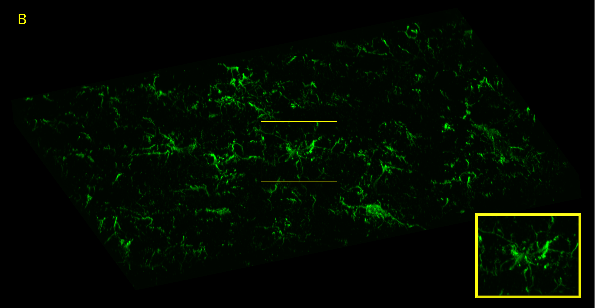

# ReadMe
This work drew inspiration from the method published in *Nature Light: Science and Application*: [Ning, K., Lu, B., Wang, X. et al., 2023](https://www.nature.com/articles/s41377-023-01230-2)

# Self-Net
Self-Net is a two-stage Self-Supervised DL model that aims to improve the resolution isotropy for fluorescence microscopy Z-stacks with fast training and inference speed as well as high reconstruction fidelity. This repository provides a Jupyter Notebook to train and test the network, with a few minor changes to the original code created by the authors.

If you encounter any issues during execution, please refer to their source code **https://zenodo.org/records/7882519**.

Example of resolution enhacement on Spinning Disk Confocal Microscopy

## System Requirements

### General requirements

#### Software

- Python 3.9.23 (tested on)
- Conda 
- PyTorch 2.8.0. (tested on)
- CUDA version 12.8 (tested on)
- Linux (tested on Ubuntu 25.04)
- Jupyter Notebook
- Visual Studio Code

#### Hardware

- CPU or GPU that supports CUDA CuDNN and PyTorch 2.8.0
- We tested on NVIDIA RTX A4000 (16 GB)

## Installation Guide

Create a Conda Environment using the Python version specified above:

`conda create -n selfnet python=3.9.23`

Install PyTorch and other dependencies (we suggest to use *pip*). The main python dependencies include:

- Numpy
- scikit-image
- tifffile
- torch
- itertools
- threading
- opencv-python
- matplotlib
- napari

## DEMO and INFERENCE
To test the pre-trained model located in the folder *pre_trained_models* we suggest to run the notebook *test_with_pretrained.ipynd*. As an example, you can download the Z-stack from the following link:

[Z-stack](https://drive.google.com/file/d/1yH-gZ6UC3kyU0DvB28rIiPEML44Ueecf/view?usp=sharing)

The aforementioned model can also be used on your specific dataset. As these models are extremely sensitive to the type of data used, we recommend that you check the representation used in your dataset (e.g. uint8, float16, etc). The model is trained on images in float 16. Inside the notebook you should also specify what are the minimum and maximum values of intesity in you images. This is needed to don't have weird artifacts in the output.

## TRAINING

To train the model, two steps are required: generating the dataset and running the training.

### Data generation

The first step in carrying out the training is to generate the dataset. Starting with a single z-stack, we will create our dataset using the raw data and then, subsequently, the dataset in *.npy* format, which will be used for the training.

To generate the dataset run the notebook *data_generation.ipynb*. As mentioned in the **DEMO and INFERENCE** section, It is essential to set up the initial stack in a specific way. We recommend converting the dataset to float16 (e.g. *tifffile.imwrite('your_sample.tif', input.astype(np.float16))*) and then passing it to int8 using fiji (*image -> type -> 8 bit*) before executing the notebook.

This recommendation is made because it has been observed that the network operates most effectively when these conditions are met.

### Training step
Once the dataset has been generated, you can run the notebook *training.ipynb* to train your model. In the notebook, it will be possible to modify certain parameters, including the architecture of the various networks within the entire model.

During training, the notebook will save several model checkpoints. You can view the intermediate results in the *checkpoints* folder that it will generate and thus monitor the progress of the network training.

Once the training is complete, you can select the best model based on the intermediate results.

# TEST

After completing the training, we are ready to test the model. To do this, run the notebook *test.ipynb*. In this case too, you will need to specify certain parameters, including the maximum and minimum intensity values in your dataset (if you are testing the model on the initial dataset, these values will be the same as those found in *training.ipynb*)

Once the test is complete, the model will save the output to the *results* folder.

The notebook includes an optional section for viewing the output in Napari. Please do not run the specified cell if you do not intend to view it straight away and plan to open it at a later time.