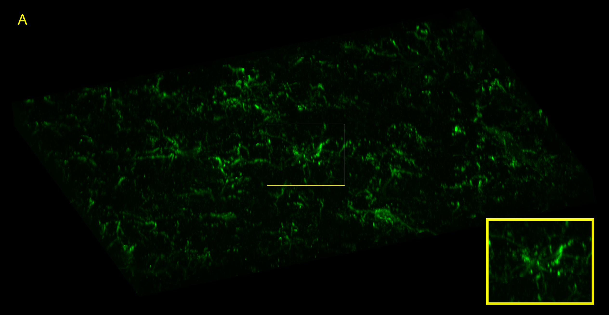
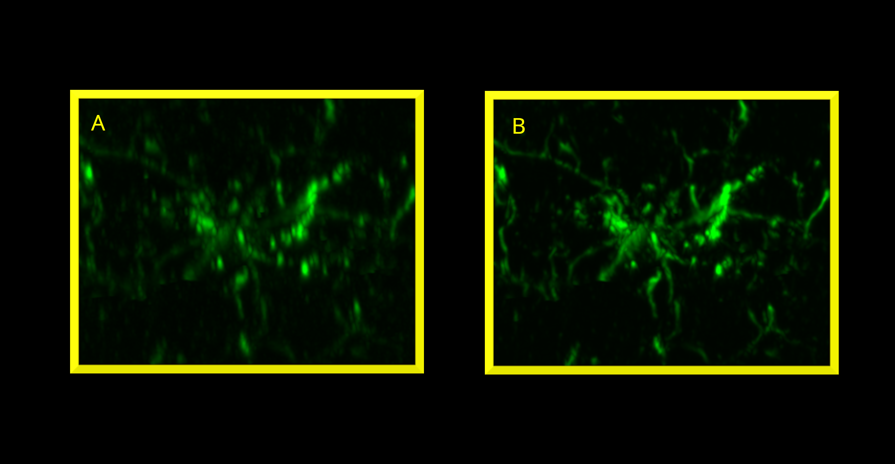

# ReadMe
This work drew inspiration from the method published in *Nature Light: Science and Application*: [Ning, K., Lu, B., Wang, X. et al., 2023](https://www.nature.com/articles/s41377-023-01230-2)

# Self-Net
Self-Net is a two-stage Self-Supervised DL model that aims to improve the resolution isotropy for fluorescence microscopy Z-stacks with fast training and inference speed as well as high reconstruction fidelity. This repository provides a Jupyter Notebook to train and test the network, with a few minor changes to the original code created by the authors.

If you encounter any issues during execution, please refer to their source code **https://zenodo.org/records/7882519**.

Example of resolution enhacement on Spinning Disk Confocal Microscopy

## System Requirements

### General requirements

#### Software

- Python 3.9.23 (tested on)
- Conda 
- PyTorch 2.8.0. (tested on)
- CUDA version 12.8 (tested on)
- Linux (tested on Ubuntu 25.04)
- Jupyter Notebook
- Visual Studio Code

#### Hardware

- CPU or GPU that supports CUDA cuDNN and PyTorch 2.8.0
- We tested on NVIDIA RTX A4000 (16 GB)